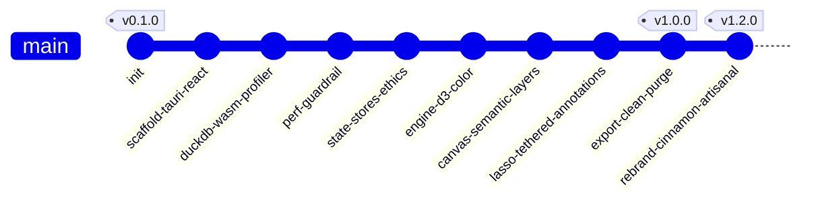
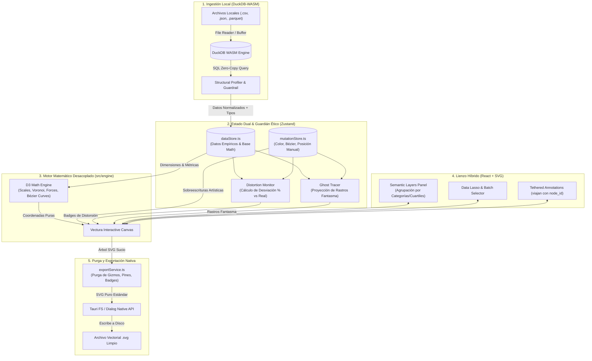

# PROJECT_MAP.md — Cinnamon Atelier (Taller de Datos & Arte Vectorial para macOS)

> Arquitectura de software, grafo de versiones y flujo reactivo para Cinnamon: la estación de trabajo nativa de macOS con estética cálida artesanal (tonos canela, ámbar y crema), icono botánico de ramita de canela y analítica local en memoria con DuckDB-WASM y D3.

---

## 1. Grafo de Versiones Git

---

## 2. Tabla de Checkpoints y Estado del Sistema

| Checkpoint | Módulo / Fase | Descripción | Estado |
| :--- | :--- | :--- | :--- |
| **CP-00** | Andamiaje Base | `git init`, `PROJECT_MAP.md`, `BITACORA.md`, asignación de puerto dedicado (5220). | **Completado** |
| **CP-01** | Fase 1: Tauri + React + macOS HIG | Tauri v2, React 19, TypeScript, Tailwind CSS con tokens nativos de macOS y diseño Human Premium (`unslop`). | **Completado** |
| **CP-02** | Fase 1: Motor DuckDB-WASM | Ingestión local en memoria para CSV, JSON y Parquet sin dependencias externas (`/public/duckdb/`). | **Completado** |
| **CP-03** | Fase 1: Asistente Estructural & Guardarraíl | Profiler de columnas, gráficos compatibles iluminados, incompatibles deshabilitados y guardarraíl >10k nodos SVG. | **Completado** |
| **CP-04** | Fase 2: Zustand Stores (`dataStore` & `mutationStore`) | Separación estricta de coordenadas empíricas algorítmicas y mutaciones artísticas. | **Completado** |
| **CP-05** | Fase 2: Ética Vectorial & Fantasmas | Anclaje (`pinned`), rastros fantasma hacia coordenadas matemáticas y monitor de distorsión empírica (`Δ %`). | **Completado** |
| **CP-06** | Fase 3: Engine D3 Desacoplado & Color | D3.js en `src/engine/` para física/escalas sin tocar el DOM. Paletas editoriales y modos de fusión SVG. | **Completado** |
| **CP-07** | Fase 4: Lienzo Híbrido & Capas Semánticas | Canvas interactivo SVG con zoom/pan, capas semánticas por dimensiones de datos y lazo contextual. | **Completado** |
| **CP-08** | Fase 4: Anotaciones Atadas | Callouts, flechas y texto en trayectoria anclados al `node_id` que viajan con los datos. | **Completado** |
| **CP-09** | Fase 5: Purga DOM & Exportación SVG | Limpieza estricta de gizmos/fantasmas en `exportService.ts` y guardado nativo con Tauri Dialog/FS. | **Completado** |
| **CP-10** | Verificación Zero-Defect | Batería en 5 frentes: typecheck (0 errores), tests (15/15 pasados), build de producción y socket liveness (HTTP 200 en puerto 5220). | **Completado** |
| **CP-11** | Lanzadores de Escritorio macOS | Accesos directos creados: `Cinnamon.app` y `Cinnamon.command` en el Escritorio con resolución portable de paths y socket liveness. | **Completado** |
| **CP-12** | Rediseño Ergonómico Accesible | Barra de inicio rápido con carga de datos en 1 clic y panel inspector lateral amigable para editar puntos. | **Completado** |
| **CP-13** | Rebranding a Cinnamon & Logo Botánico | Renombrado oficial a **Cinnamon**, generación del icono de ramitas de canela (`icon.icns`), y purga total de zonas oscuras a favor de tonos crema, vainilla y ámbar canela. | **Completado** |
| **CP-14** | Auditoría Estética Radical & Limpieza de Capas | Eliminación definitiva del contraste Frankenstein (barras oscuras sobre lienzo blanco). Reestructuración semántica de capas (agrupación por región en 5 carpetas limpias en vez de 30 tarjetas individuales) y eliminación de cadenas crudas con corchetes. | **Completado** |

---

## 3. Arquitectura del Flujo Reactivo de Datos

---

## 4. Estado de la Sesión

- **Estado Actual**: Todas las 5 fases implementadas, batería Zero-Defect verificada con 15/15 tests automatizados, tipado estricto `tsc` sin errores, build de producción generado y servidor dev activo en puerto 5220.
- **Siguiente Paso**: Commit atómico y entrega al usuario con reporte técnico y guía de operación.
