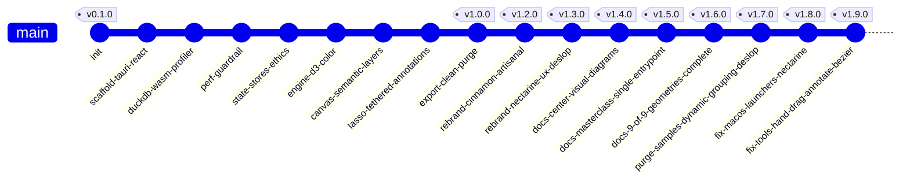
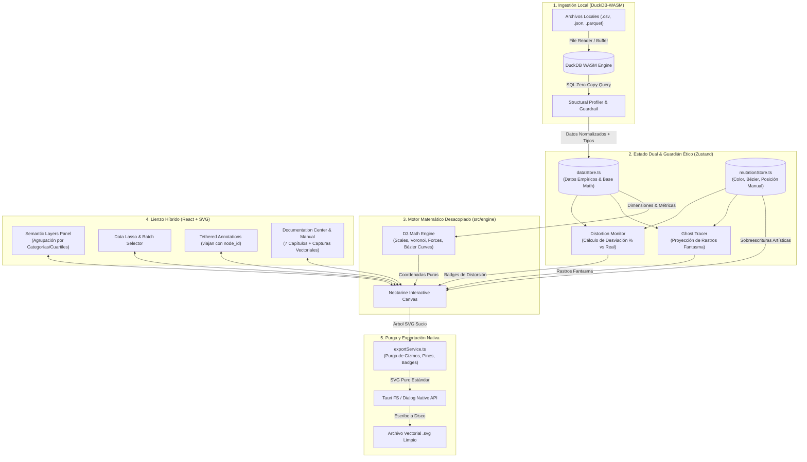

# PROJECT_MAP.md — Nectarine Studio (Taller de Datos & Arte Vectorial para macOS)

> Arquitectura de software, grafo de versiones y flujo reactivo para Nectarine: la estación de trabajo nativa de macOS con estética cálida de taller editorial (tonos néctar, melocotón y crema marfil), icono esculpido de fruta fresca y analítica local en memoria con DuckDB-WASM y D3.

---

## 1. Grafo de Versiones Git

---

## 2. Tabla de Checkpoints y Estado del Sistema

| Checkpoint | Módulo / Fase | Descripción | Estado |
| :--- | :--- | :--- | :--- |
| **CP-00** | Andamiaje Base | `git init`, `PROJECT_MAP.md`, `BITACORA.md`, asignación de puerto dedicado (5220). | **Completado** |
| **CP-01** | Fase 1: Tauri + React + macOS HIG | Tauri v2, React 19, TypeScript, Tailwind CSS con tokens nativos de macOS y diseño Human Premium (`unslop`). | **Completado** |
| **CP-02** | Fase 1: Motor DuckDB-WASM | Ingestión local en memoria para CSV, JSON y Parquet sin dependencias externas (`/public/duckdb/`). | **Completado** |
| **CP-03** | Fase 1: Asistente Estructural & Guardarraíl | Profiler de columnas, gráficos compatibles iluminados, incompatibles deshabilitados y guardarraíl >10k nodos SVG. | **Completado** |
| **CP-04** | Fase 2: Zustand Stores (`dataStore` & `mutationStore`) | Separación estricta de coordenadas empíricas algorítmicas y mutaciones artísticas. | **Completado** |
| **CP-05** | Fase 2: Ética Vectorial & Fantasmas | Anclaje (`pinned`), rastros fantasma hacia coordenadas matemáticas y monitor de distorsión empírica (`Δ %`). | **Completado** |
| **CP-06** | Fase 3: Engine D3 Desacoplado & Color | D3.js en `src/engine/` para física/escalas sin tocar el DOM. Paletas editoriales y modos de fusión SVG. | **Completado** |
| **CP-07** | Fase 4: Lienzo Híbrido & Capas Semánticas | Canvas interactivo SVG con zoom/pan, capas semánticas por dimensiones de datos y lazo contextual. | **Completado** |
| **CP-08** | Fase 4: Anotaciones Atadas | Callouts, flechas y texto en trayectoria anclados al `node_id` que viajan con los datos. | **Completado** |
| **CP-09** | Fase 5: Purga DOM & Exportación SVG | Limpieza estricta de gizmos/fantasmas en `exportService.ts` y guardado nativo con Tauri Dialog/FS. | **Completado** |
| **CP-10** | Verificación Zero-Defect | Batería en 5 frentes: typecheck (0 errores), tests (19/19 pasados), build de producción y socket liveness (HTTP 200 en puerto 5220). | **Completado** |
| **CP-11** | Lanzadores de Escritorio macOS | Accesos directos creados: `Nectarine.app` y `Nectarine.command` en el Escritorio con resolución portable de paths y socket liveness. | **Completado** |
| **CP-12** | Rediseño Ergonómico Accesible | Barra de inicio rápido con carga de datos en 1 clic y panel inspector lateral amigable para editar puntos. | **Completado** |
| **CP-13** | Rebranding a Cinnamon & Logo Botánico | Renombrado a Cinnamon, generación de quills e icono `.icns`. | **Completado** |
| **CP-14** | Auditoría Estética Radical & Limpieza de Capas | Eliminación del contraste Frankenstein y estandarización a diseño cálido marfil. | **Completado** |
| **CP-15** | Rediseño de Iconografía de Alta Gama | Reemplazo del logo por renderizado 3D de alta fidelidad. | **Completado** |
| **CP-16** | Expansión Visual Cinnamon: Radial, Espiral, Celestial & Resplandor SVG | Cuerdas radiales, espirales áureas, cartas celestiales y filtros de luz `<feGaussianBlur>`. | **Completado** |
| **CP-17** | Rebranding a Nectarine, Desahogo UX/UI & Iconografía Esculpida | Renombrado oficial a **Nectarine** (`com.nectarine.studio`), icono 3D de fruta fresca, purga de 'DuckDB Local' y 'Atelier Gráfico & Analítico', barra aireada con etiquetas contextuales y paleta *Nectarine & Melocotón*. | **Completado** |
| **CP-18** | Centro de Documentación Integral & Diagramas Visuales Paso a Paso | Módulo `DocumentationModal.tsx` de 7 capítulos con explicaciones en lenguaje claro, capturas esquemáticas vectoriales incrustadas, acceso inicial y atajo `<kbd>?</kbd>`. | **Completado** |
| **CP-19** | Unificación de Acceso al Manual & Expansión Enciclopédica Masterclass | Eliminación del botón duplicado en `Toolbar.tsx` liberando espacio horizontal. Expansión exhaustiva de `DocumentationModal.tsx` a 9 capítulos profundos. | **Completado** |
| **CP-20** | Desglose Individual Íntegro de las 9 de 9 Geometrías Maestras | Separación rigurosa de las 9 geometrías en 9 fichas individuales independientes numeradas del 1 al 9 (Dispersión, Burbujas, Barras, Voronoi, Red de Fuerza, Ondas, Cuerdas Radiales, Espiral Áurea, Mapa Celestial), cada una con su propia miniatura SVG vectorial, fundamento matemático, directrices de 'Ideal para' y 'Evitar cuando', más selector interactivo por categoría (Todas, Cartesianas, Redes, Visual Cinnamon). | **Completado** |
| **CP-21** | Purga de Datos Muestra, Lienzo con Dropzone & Agrupación Dinámica Multicolumna | Eliminación radical de muestras precargadas (`paises_y_desarrollo.csv` y `ventas_tecnologia.csv`). El lienzo arranca limpio con tarjeta interactiva de soltar archivos (drag & drop). En el panel de Capas Semánticas se implementó selector de columna primaria y sub-agrupación secundaria jerárquica con recálculo en tiempo real. Erradicación completa de clases oscuras en `DataProfilerModal`, `DataLasso` y `App`. | **Completado** |
| **CP-22** | Resiliencia de Lanzadores macOS & Firma de Código | Corrección de firma de código rota (`a sealed resource is missing or invalid`), desacople total de Terminal en `Nectarine.app`, invocación asíncrona de `launch-desktop.sh`, apertura garantizada de UI en navegador, recuperación de puerto 5220 ante procesos colgados y actualización de `Nectarine.command`. | **Completado** |
| **CP-23** | Reparación Integral de Herramientas & Purga de Anotación Ficticia | Herramienta de Mano (`pan`) añadida para encuadre del lienzo, arrastre de nodos con compensación de escala por zoom 1:1, manetas Bézier con cálculo relativo libre de saltos a infinito, creación interactiva de anotaciones al hacer clic sobre cualquier nodo, botón de eliminación rápida (`×`) en tarjetas y erradicación definitiva del comentario precargado de PIB/esperanza de vida. | **Completado** |

---

## 3. Arquitectura del Flujo Reactivo de Datos

---

## 4. Estado de la Sesión

- **Estado Actual**: Herramientas de lienzo de Nectarine 100% operativas (Mano/Pan, Puntero de selección, Arrastre/Move con zoom 1:1, Curvar Bézier con delta relativo sin saltos y Anotación interactiva al clic con callouts atados). Comentario precargado ficticio purgado en su totalidad. 23/23 tests unitarios aprobados, tipado estricto `tsc` con 0 errores y build de producción validado en 2.17s.
- **Siguiente Paso**: Commit atómico y entrega al usuario con reporte técnico y guía de operación.
